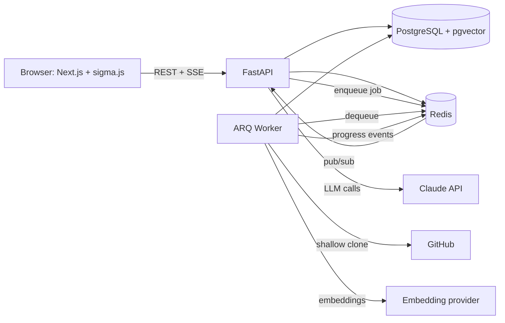
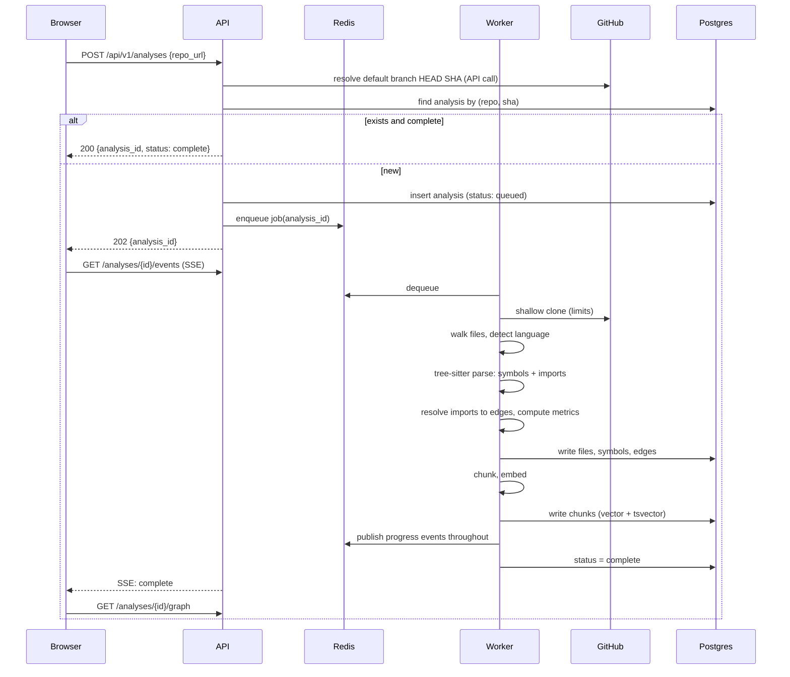

# ARCHITECTURE.md

## 1. System overview



Components and responsibilities:

| Component | Responsibility | Never does |
|---|---|---|
| Web (Next.js) | UI, graph canvas, chat panel, calls the API | Talks to GitHub or LLM directly |
| API (FastAPI) | Auth, validation, job creation, reads, retrieval, LLM orchestration, SSE | Parses repositories or does heavy CPU work |
| Worker (ARQ) | Clone, parse, build graph, chunk, embed, summaries | Serves HTTP |
| Postgres | Source of truth: users, repos, analyses, files, symbols, edges, chunks | Holds secrets in plain text |
| Redis | Job queue, progress pub/sub, sessions, caches, rate-limit counters | Is the source of truth for analysis data |

## 2. Core concepts

- **Analysis**: one processed snapshot of a repo at a specific commit SHA. Unique on `(repo_id, commit_sha)`. Idempotent: submitting the same repo at the same SHA returns the existing analysis.
- **Graph**: nodes are files, edges are file-to-file imports. Symbols (functions, classes) are stored per file for search and detail panels but are not graph nodes in the MVP.
- **Cluster**: MVP groups files by top-level directory. Louvain community detection is a stretch step.
- **Chunk**: a retrievable unit of code, one per symbol (function, class, method), with a fallback to fixed-size windows for files without symbols.
- **Citation**: a reference from an answer to a retrieved chunk, which maps to a file and line range, which maps to a graph node.

## 3. Data flows

### 3.1 Analysis pipeline



Stages and progress events: `queued`, `cloning`, `scanning`, `parsing`, `linking`, `embedding`, `complete`, `failed`. Each event carries a percent and a message.

### 3.2 Question answering

1. Browser sends `POST /api/v1/analyses/{id}/ask` with the question. Response is `text/event-stream`. The client reads it with `fetch` and a stream reader, because `EventSource` supports GET only.
2. API runs hybrid retrieval: full-text query and vector query against `chunks` for that analysis, merges with Reciprocal Rank Fusion, optionally reranks, keeps top K.
3. API builds the prompt: system rules, delimited untrusted code context with chunk IDs, the question.
4. LLM streams the answer with citation markers `[c:<chunk_id>]`.
5. API validates every cited chunk ID is in the retrieved set. Invalid citations are dropped and logged.
6. API emits SSE events: `token`, `citation` (chunk id, file path, line range, node id), `done` (usage, latency).
7. Frontend highlights cited nodes on the graph.

### 3.3 Agent mode (Phase 3)

A tool loop with read-only tools: `search_symbol`, `get_dependents`, `get_dependencies`, `read_file`, `trace_path`. Bounded iterations (default max 6), bounded tokens, every tool call logged. Used for questions that need multi-hop reasoning ("how does a request reach the database?").

### 3.4 Impact analysis

- Input: node (file) and depth N.
- Computation: reverse BFS over import edges to depth N, returning dependents with their depth.
- MVP is file-level. `get_callers` at symbol level is a heuristic (name matching inside dependent files) and the UI labels it as approximate.
- The LLM then explains the risk using the dependent list and the relevant chunks.

## 4. Data model (initial)

```
users(id, github_id, login, avatar_url, created_at)

repos(id, owner, name, url, created_at)   unique(owner, name)

analyses(id, repo_id, commit_sha, status, stage, error,
         stats jsonb, created_by, created_at, completed_at)
         unique(repo_id, commit_sha)

files(id, analysis_id, path, language, loc, complexity,
      churn, cluster, size_bytes)
      index(analysis_id, path)

symbols(id, file_id, name, kind, start_line, end_line, signature)
        index(file_id), index(name)

edges(id, analysis_id, source_file_id, target_file_id, kind, weight)
      index(analysis_id, source_file_id), index(analysis_id, target_file_id)

chunks(id, analysis_id, file_id, symbol_id nullable, content,
       start_line, end_line, token_count,
       embedding vector(N), tsv tsvector)
       index: HNSW or IVFFlat on embedding (decided in P3-S01), GIN on tsv

summaries(id, analysis_id, scope, scope_ref, content, model, created_at)

conversations(id, analysis_id, user_id, created_at)
messages(id, conversation_id, role, content, citations jsonb, usage jsonb, created_at)

eval_runs(id, dataset, git_sha, metrics jsonb, created_at)
```

`N` (embedding dimension) is fixed by the embedding model chosen in ADR-011. Changing the model requires re-embedding.

## 5. API surface (v1)

| Method | Path | Purpose |
|---|---|---|
| GET | `/health` | Liveness |
| GET | `/api/v1/auth/github/login` | Start OAuth |
| GET | `/api/v1/auth/github/callback` | Finish OAuth, set session cookie |
| POST | `/api/v1/auth/logout` | End session |
| GET | `/api/v1/me` | Current user |
| POST | `/api/v1/analyses` | Create or fetch analysis for a repo URL |
| GET | `/api/v1/analyses/{id}` | Status and stats |
| GET | `/api/v1/analyses/{id}/events` | SSE progress |
| GET | `/api/v1/analyses/{id}/graph` | Nodes, edges, clusters |
| GET | `/api/v1/analyses/{id}/files/{file_id}` | File details and symbols |
| POST | `/api/v1/analyses/{id}/ask` | Streaming Q&A (SSE over POST) |
| GET | `/api/v1/analyses/{id}/impact` | Impact analysis (`node`, `depth`) |
| GET | `/api/v1/analyses/{id}/overview` | Cached architecture summary |
| GET | `/api/v1/gallery` | Pre-analyzed repos (public, no auth) |

Rules: all request and response bodies are Pydantic models. OpenAPI schema is the contract. The frontend types are generated from it.

## 6. Frontend architecture

- **Ownership split**: React renders UI chrome (panels, search, filters, chat). sigma owns the canvas. They communicate through a Zustand store: `selectedNodeId`, `hoveredNodeId`, `highlightedNodeIds`, `colorMode`, `filters`, `impactDepth`.
- **Highlighting** uses sigma `nodeReducer` and `edgeReducer` reading from the store, so highlight changes do not rebuild the graph.
- **Layout**: ForceAtlas2 runs in a Web Worker so the UI thread stays responsive. Positions are cached after convergence.
- **Phase 1** uses a mock `RepoGraph` JSON behind the same data-access functions the real API will use, so Phase 2 swaps the source without touching components.
- **Types**: `GraphNode`, `GraphEdge`, `RepoGraph` are defined in P1-S01 and later replaced by generated types with identical shape.

## 7. Search design

- Chunk per symbol with file path and signature prepended to the embedded text.
- Full-text: `websearch_to_tsquery` over `tsv`, ranked with `ts_rank_cd`.
- Vector: cosine distance via pgvector.
- Fusion: Reciprocal Rank Fusion with k = 60 over the two ranked lists. Top K (default 12) go to the LLM.
- Optional rerank step measured in the eval harness. Keep it only if it improves recall@k or answer correctness.

## 8. Eval design

- Dataset: 3 repositories pinned to commit SHAs, 40 or more questions total.
- Each question has: gold files, a reference answer, a category (locate, explain, trace, impact).
- Metrics: retrieval recall@k, citation precision (cited file in gold set), answer correctness (LLM-as-judge with a rubric against the reference), latency, cost.
- Runs through a script (`evals/run_eval.py`) that writes a row to `eval_runs` and prints a table. Results go in the README.

## 9. Limits (defaults, configurable in `core/limits.py`)

| Limit | Default |
|---|---|
| Repo clone size | 100 MB |
| Clone timeout | 60 s |
| Files parsed per analysis | 5,000 |
| Single file size parsed | 1 MB |
| Analysis total timeout | 5 min |
| Concurrent analyses per user | 2 |
| Questions per user per day | configurable cap |
| Max agent iterations | 6 |

Exceeding a limit produces a clear `failed` status with a human-readable reason, never a crash.

## 10. Security

- Only public `github.com` HTTPS URLs are accepted. Reject everything else (SSRF protection). Parse and validate the URL, then build the clone URL yourself.
- Never run, import, build, or install anything from a cloned repo. Parse only.
- Clone into an isolated temporary directory, delete after parsing. Disable git hooks and submodule recursion. Pass arguments as a list, never through a shell.
- Treat repo content as untrusted prompt input: delimit it, state in the system prompt that it is data, keep tools read-only, never let content change tool permissions.
- Render markdown answers safely. No raw HTML from model output.
- Session cookie: httpOnly, secure in production, SameSite set deliberately. CSRF protection on state-changing routes.
- Secrets only from environment variables. Never log tokens or full prompts containing user data at info level.
- Rate limit by user and by IP using Redis counters.

## 11. Caching and cost control

- Analysis results cached by `(repo, sha)`.
- Summaries cached per analysis and scope.
- Identical `(analysis, normalized question)` answers cached for a short TTL.
- Cheaper model for summaries and bulk work, stronger model for Q&A and agent.
- Every LLM call records model, input tokens, output tokens, latency, and estimated cost in `messages.usage`.

## 12. Observability

- Structured JSON logs with a request ID and analysis ID on every line.
- Metrics (Phase 4): request latency histograms, queue depth, job duration, LLM latency and cost.
- Optional LLM tracing tool decided in P3-S10.

## 13. Failure modes and handling

| Failure | Handling |
|---|---|
| Worker crashes mid-job | Job is retried by ARQ. Pipeline stages are idempotent and clear partial rows for the analysis before rewriting. |
| Clone fails or times out | Analysis marked `failed` with reason. No retry for permanent errors (404, too large). |
| Duplicate submissions | Unique constraint on `(repo_id, commit_sha)` plus enqueue only on insert. |
| LLM API error or timeout | Bounded retries with backoff, then a clear error event on the SSE stream. |
| Invalid citation from model | Dropped, logged, counted in eval metrics. |
| Redis unavailable | API returns 503 for job-dependent routes. Reads from Postgres still work. |

## 14. Scaling story (interview material)

- API is stateless. Scale horizontally behind a load balancer. Sessions live in Redis.
- Workers scale independently by queue depth. Backpressure through bounded queue and per-user concurrency limits.
- Reads of finished graphs are served from Postgres with indexed lookups and can be cached at the edge (immutable per SHA).
- pgvector handles per-analysis search by filtering on `analysis_id`. If a single analysis grows beyond what one index handles well, partition chunks by analysis or move vectors to a dedicated store. Record the decision in an ADR if it ever happens.
